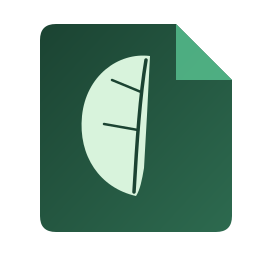

<div align="center">



# Folium

### An AI-native document, knowledge, and file engine — in C++, built in the open, test-first.

[](LICENSE)
[](#)
[](https://github.com/srikrishna-00/folium/actions/workflows/ci.yml)
[](#project-status)

[Project status](#project-status) · [What exists today](#what-exists-today) · [Quick start](#quick-start) · [Architecture](#architecture) · [Documentation](#documentation) · [Load behavior](#load-and-stress-behavior) · [Contributing](#contributing) · [License](#license)

</div>

---

## Project status

**This is an early-stage native core, not a finished application.** There is no installer, no
mobile app, no desktop app, and no UI yet — what exists is a set of real, independently tested
C++ engines (documents, search, PDF viewing, OCR, encryption, an AI-provider abstraction) that a
future application will be built on top of. If you're looking for something you can install and
use today, this isn't that yet. If you're looking for a from-scratch, test-first native core for
a Notion-style knowledge/document/PDF/AI platform, this is actively being built in the open and
every claim below is backed by a real test you can run yourself.

The long-term goal (see [`docs/MASTER_PROMPT.md`](docs/MASTER_PROMPT.md)) is a single
application combining a Notion-like workspace, a PDF/document platform, a scanner, OCR, universal
file conversion, AI-assisted knowledge work, end-to-end encrypted sync, and offline-first mobile
and desktop apps. That is a multi-year scope (the project's own engineering estimate puts v1.0 at
roughly 1,000 engineer-weeks). What's below is the foundation layer, built one honestly-scoped,
independently-verified slice at a time.

## What exists today

Every module below is real, builds clean at `-Werror`, has a real test suite, and has been
verified independently (not just "the code compiles") — see [`docs/changelog.md`](docs/changelog.md)
for the full, honest history of every slice, including what each one explicitly does **not** do
yet.

| Module | What it is | Status |
|---|---|---|
| `core/notes` | Flat note CRUD + full-text search (the original bootstrap slice) | Superseded by `core/blocks`, kept for the frozen C ABI it backs |
| `core/blocks` | A real Notion-style block/page document model (8 block types, nesting, reorder) | Working, tested |
| `core/search` | Unified FTS5 search across notes **and** blocks, with a single ranked result set | Working, tested |
| `core/database` | Property-typed databases (Text/Number/Select/Multi-select/Date/Boolean) with Table views, filters, sorts | Working, tested |
| `core/conversion` | Bidirectional Markdown ⟷ block-model conversion, with an honest fidelity report for lossy constructs | Working, tested |
| `file-engine/detection` | Magic-byte file-type detection (never trusts the extension alone) across 10 real formats | Working, tested, fuzzed |
| `pdf-engine/reader` | Read-only PDF viewing (open/measure/render) on a vendored PDFium | Working, tested, fuzzed — **bootstrap dependency, see below** |
| `ocr/engine` | Printed-text OCR with real bounding boxes and confidence, on a vendored Tesseract | Working, tested — printed text only |
| `security/crypto` | X25519, XChaCha20-Poly1305 AEAD, Argon2id, on libsodium | Working, tested against external published test vectors |
| `security/keys` | The E2EE key hierarchy (recovery phrase → root key → workspace key → per-document key) | Working, tested — **not yet wired into storage** |
| `ai/provider` + `ai/local` | A provider-independent AI abstraction, with one real local (non-ML, non-generative) implementation | Working, tested — **no generative/cloud provider implemented** |
| `core/capi` | A stable, versioned C99 ABI over every module above, for future mobile bindings | Working, tested |
| `core/sync/spike` | A standalone research spike proving the Fugue CRDT algorithm correct before any production sync code is written | Research only, isolated from the product build |

**Explicitly not implemented yet**, so nobody mistakes silence for "it works": the scanner/camera
pipeline (needs a physical device), a generative or cloud AI provider (needs network/API access
this build doesn't assume), RAG (chunking/embeddings/retrieval), the agent framework, production
sync (the CRDT is *proven correct in isolation*, not wired into the app), encryption wired into
actual document storage, any mobile or desktop application, and collaboration/permissions/versioning.
Every one of these has a specific, documented reason in the relevant module's own header — this
project tries hard not to let a silent gap pass as a finished feature.

## Quick start

You'll need a C++17 compiler, CMake ≥ 3.20, and SQLite3 with FTS5 (ships with macOS/most Linux
distros). A few modules are optional and auto-detected — PDF viewing needs a vendored PDFium,
encryption needs libsodium, OCR needs Tesseract; the build configures and runs fine without any
of them, it just skips that module and says so.

```bash
git clone https://github.com/srikrishna-00/folium.git
cd folium

# optional: enable PDF/crypto/OCR if you have the dependencies
# brew install libsodium tesseract            # macOS
# third_party/pdfium/fetch_pdfium.sh           # PDF viewing (prebuilt bootstrap)

cmake -S . -B build -DCMAKE_BUILD_TYPE=Debug
cmake --build build -j
ctest --test-dir build
```

A clean checkout with no optional dependencies installed still configures, builds, and passes its
full test suite — the project is deliberately designed so a contributor's first `cmake` never
fails for a reason that has nothing to do with the code they're there to change.

To see the original end-to-end slice work (create → store → search → open → edit → save), run:

```bash
./build/tools/notes_cli/uapp-notes --db /tmp/folium-demo.db demo
```

## Architecture

```
                         USER INTERFACE  (not built yet)
                               |
                       PLATFORM BRIDGE
              core/capi — a versioned, frozen C99 ABI
                               |
            +------------------+------------------+
            |         |        |         |         |
         notes     blocks   search   database  conversion
            |         |________|_________|_________|
            |                  |
         file-engine        pdf-engine         ocr-engine
      (type detection)    (PDFium, viewing)  (Tesseract, printed text)
            |                  |                   |
            +------------------+-------------------+
                               |
                      security/crypto + keys
                 (libsodium — E2EE primitives, not yet wired in)
                               |
                         STORAGE (SQLite)
```

Every engine above core/capi is a separate, independently-testable library with its own minimal
dependency footprint — verified, not just claimed, via `nm -u` checks in CI that confirm (for
example) that the document model can never accidentally link SQLite directly, or that the crypto
module is the *only* thing in the tree that can see libsodium's headers. The full architectural
reasoning — including the real tradeoffs considered and rejected for each major fork — lives in
[`docs/adr/`](docs/adr/).

## Documentation

This project writes its reasoning down, not just its code. Start here:

- [`docs/MASTER_PROMPT.md`](docs/MASTER_PROMPT.md) — the full product vision and scope
- [`docs/architecture.md`](docs/architecture.md) — system architecture and layering
- [`docs/changelog.md`](docs/changelog.md) — every slice, in order, with what it does and does **not** do
- [`docs/adr/`](docs/adr/) — Architecture Decision Records for every real fork (e.g. why a
  Database is anchored to a Page rather than being one; why `core/blocks` supersedes `core/notes`)
- [`docs/spikes/`](docs/spikes/) — pre-implementation research, including one that caught a
  published correctness defect in a CRDT algorithm *before* any production code was written for it
- [`docs/security-model.md`](docs/security-model.md) — the threat model and the E2EE key hierarchy design
- [`docs/risk-register.md`](docs/risk-register.md) — scored, owned risks, reviewed as the project evolves
- [`THIRD_PARTY_NOTICES`](THIRD_PARTY_NOTICES) — every vendored dependency, its license, and exactly
  what's still owed before each one leaves "local dev bootstrap" status

## Load and stress behavior

See [`docs/load-test-results.md`](docs/load-test-results.md) for real, measured behavior of each
engine under increasing data volume and operation count — latency growth, peak memory against the
project's 2GB-RAM device floor, and an honest account of where behavior stays smooth versus where
it degrades and why.

## Contributing

See [`docs/contributing.md`](docs/contributing.md). Short version: every change ships with real
tests, every new third-party dependency gets a license review before it's added, and every
non-obvious architectural decision gets written down, not just coded.

## Security

Found a security issue? Please don't open a public issue — see
[`docs/security-model.md`](docs/security-model.md) for the current threat model and open items,
and reach out privately first. Note the project's own honest status: encryption primitives and
the key hierarchy exist and are tested, but are **not yet wired into document storage** — treat
nothing in this repository as providing confidentiality for real data yet.

## License

Apache License, Version 2.0 — see [`LICENSE`](LICENSE). Third-party dependencies retain their own
licenses; see [`THIRD_PARTY_NOTICES`](THIRD_PARTY_NOTICES).
